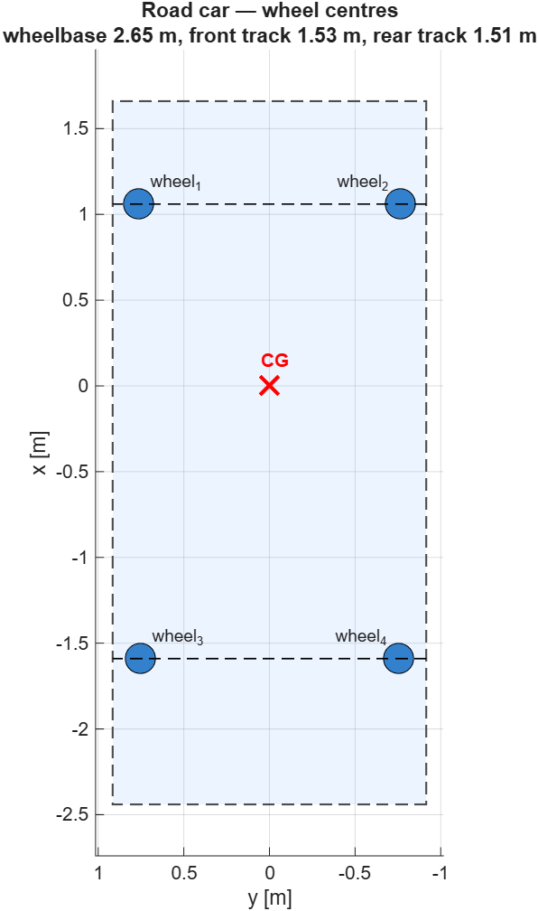

# vehkit

A MATLAB toolbox for vehicle data management: a JSON schema for vehicle
definitions, a strict validator with identifiable error identifiers, and
derived geometric properties.



## Problem

Vehicle engineering projects — lap time simulation, suspension kinematics,
tyre modelling, control design, machine learning on vehicle states — all
need the same starting point: a consistent, validated description of the
vehicle. Every project that reads vehicle parameters on its own
re-invents the same schema, gets the same conventions wrong, and produces
data that cannot be compared across tools.

vehkit provides that shared foundation: a JSON contract, a validator that
enforces it, and derived properties that every downstream project can
rely on.

## What it does

vehkit reads a vehicle definition from a JSON file, validates it against
the schema, and returns a canonical MATLAB struct. From that struct, it
calculates geometric properties that downstream projects need:

- `vehkit.load(filename)` — read a JSON file into a vehicle struct.
- `vehkit.validate(vehicle)` — check structural and physical constraints,
  normalize collections, and return the canonical form.
- `vehkit.save(vehicle, filename)` — validate and write back to JSON,
  with pretty printing and UTF-8 without BOM.
- `vehkit.geometry.wheelbase(vehicle)` — distance between the first and
  last axle.
- `vehkit.geometry.trackWidths(vehicle)` — track width of each axle.
- `vehkit.geometry.cgToAxles(vehicle)` — signed longitudinal distance
  from CG to each axle.
- `vehkit.geometry.wheelCentres(vehicle)` — N-by-3 matrix of wheel centre
  coordinates in the global frame.

## What it is not

vehkit does not simulate vehicle dynamics, does not fit tyre models, and
does not import CAD. It is the data contract that other tools build on.
Simulation, tyre fitting and CAD extraction are separate projects in the
same portfolio.

## Method

The JSON schema is versioned (`schema_version: "0.1"`) and documented in
`docs/SCHEMA.md`. It covers geometry (axles, wheels, CG), mass and
inertia, and the reference load configuration. Optional blocks for tyres
and aerodynamics are reserved but not yet validated.

Validation is strict and produces identifiable error identifiers
(`vehkit:invalidJSONStructure`, `vehkit:invalidParameter`,
`vehkit:invalidInertia`, `vehkit:axleOrderMismatch`,
`vehkit:wheelOrderMismatch`, `vehkit:conflictingGeometryDefinition`).
Every failure has a code that downstream code can catch and react to,
not a free-form message.

Inertia validation checks diagonal non-negativity, the triangle
inequalities, and positive semidefiniteness within tolerances defined in
`docs/DESIGN.md` §1.7. Geometry validation enforces axle ordering (front
to rear), wheel ordering (left to right with canonical id tie-breaking),
and mutual exclusivity between geometry definition methods.

## Results

- 57 automated tests passing (`runtests('tests')`).
- Two reference vehicles in `data/`: a generic segment C road car
  (1385 kg, 2.65 m wheelbase) and a Formula SAE-style single-seater
  (280 kg, 1.55 m wheelbase).
- Round-trip preservation of assigned data (`load` → `save` → `load`).
- Distinction between absent, unknown (null) and zero-valued data is
  preserved through the round-trip.

## Limitations

This is the **alpha** scope. The following are deliberately deferred:

- `static_load_based` geometry (only `direct` is supported).
- Static axle loads and individual wheel load distribution.
- Alternative load configurations.
- Aerodynamic calculations (the block is reserved in the schema but not
  validated).
- Semantic validation of tyre parameters.
- JSON scanner for duplicate keys and invalid key names (MATLAB's
  `jsondecode` is permissive, and the current loader relies on it).

Road surface is assumed to be flat and horizontal. Loaded radii are the
values specified in the reference configuration; variations due to static
load changes between load configurations are not modelled.

## Reproducibility

Requirements:

- MATLAB R2024a or newer (tested on R2026b Update 1).
- No additional toolboxes required for the alpha scope.

To reproduce:

1. Open `vehkit.prj` in MATLAB. The project adds `src/` to the path
   automatically.
2. Run the test suite:
    ```runtests('tests')```
3. Regenerate the wheel centre plot:
    ```run('examples/plot_wheel_centres.m')```

The script writes `results/vehicle_plan.png`.

## Documentation

- `docs/CONVENTIONS.md` — reference frame, units, coordinate origin.
- `docs/DESIGN.md` — scope, alpha vs release split, error identifiers,
numerical tolerances.
- `docs/SCHEMA.md` — JSON data contract, field reference, serialization
rules.
- `DATA.md` — sources and notes for the canonical vehicle parameters.

## License

MIT. See `LICENSE`.

---

Part of a portfolio of 30 vehicle engineering projects.
[GitHub profile](https://github.com/RobCut)